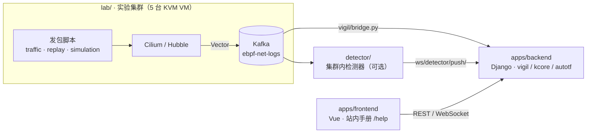
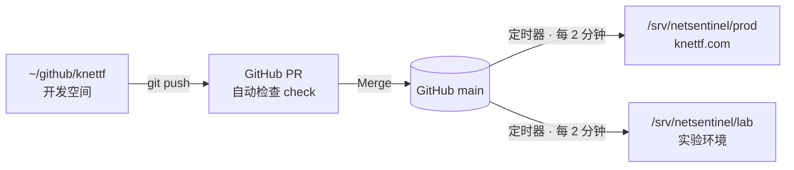

# knettf

**NetSentinel** 网络入侵检测平台，以及配套的 Kubernetes 流量实验环境（lab）。线上地址：https://knettf.com

实验集群用 Cilium/Hubble（eBPF）观测所有网络流量，经 Vector 写入 Kafka；NetSentinel 后端消费 Kafka，按五元组聚合成流特征，交给检测模型（默认 `AdsMLModel`，OCSVM）判断是否为攻击，结果存库并在前端展示。lab 负责搭集群、发正常 / 攻击流量、采集数据集、评估检测效果。

本仓库由原 `NetSentinel`（平台）和 `knetsentinel`（实验环境）两个仓库合并而来，保留了两边的提交历史。



---

## 目录结构

| 目录 | 内容 |
|------|------|
| `apps/backend/` | Django 后端。`vigil`：检测（Kafka 消费、模型、检测记录 API）；`kcore`：用户与集群管理；`autotf`：Terraform 配置扫描；`common`：公共工具 |
| `apps/frontend/` | Vue 3 + Vite 前端，包含站内使用手册（`src/views/help/`，访问 `/help`） |
| `detector/` | 集群内检测器：代码、镜像构建（`build.sh`）、K8s 清单（`k8s/`） |
| `lab/` | 实验环境：集群部署、Kafka / Vector 清单、发包、采集、数据集、检测评估。见 [lab/README.md](lab/README.md) |
| `ops/` | 运维：`deploy/`（systemd、cron、sudoers、cloudflared 配置）、`scripts/deploy.sh`（部署）、`scripts/auto-deploy.sh`（自动部署）、`scripts/check.sh`（检查） |
| `.github/workflows/` | PR 自动检查（GitHub Actions） |
| `docs/` | `structure/` 架构文档与图，`lab/` 实验相关说明（特征定义等），`archive/` 旧资料 |

Python 环境有两套，都用 [uv](https://docs.astral.sh/uv/) 管理：根目录的 `pyproject.toml` 是后端的，`lab/pyproject.toml` 是实验脚本的。

---

## 一句话流程

> 在自己的开发目录改代码 → `git push` → GitHub 网页开 PR → 自动检查通过后合并 → 服务器 2 分钟内自动上线。



---

## 日常开发（每次都这样做）

```bash
cd ~/github/knettf
git switch dev/<名字>             # 自己的长期分支（第一次：git switch -c dev/<名字> origin/main && git push -u origin dev/<名字>）
git pull --ff-only origin main   # 开工前同步 main（上次合并后的合并提交）

# …改代码、本地调试…

git add -A && git commit -m "模块：说明"
git push
```

然后在 GitHub 网页上：

1. 点 **Compare & pull request**，确认 `base: main ← compare: dev/<名字>`，**Create pull request**。
2. 等 PR 页面上的检查 **check** 变绿（约 3 分钟）。没通过就本地修好再 `git push`，PR 会自动重新检查。
3. 合并按钮选 **Create a merge commit**（不要选 Squash / Rebase）→ **Merge pull request** → **Confirm merge**。
4. **不要点 Delete branch**，个人分支下次接着用。

合并后把个人分支同步到 `main`，让两边提交号一致（GitHub 合并会在 `main` 上多出一个合并提交）：

```bash
git pull --ff-only origin main && git push
```

上线是自动的，看进度：`tail -f /srv/netsentinel/logs/auto-deploy.log`

规则（GitHub 分支保护强制执行）：`main` 只能通过 PR 合入，检查不通过不能合并，禁止直接 push / force push。

---

## 本地开发环境

### 第一次准备

```bash
git clone git@github.com:knet-lab/knettf.git ~/github/knettf    # 需加入 knet-lab 组织、配好自己的 GitHub SSH 密钥
cd ~/github/knettf
git config user.name  "<GitHub 用户名>"
git config user.email "<GitHub 上已验证的邮箱>"
```

自己创建这些文件（不在 Git 里，**不要提交**；可参考线上目录里的同名文件）：

| 文件 | 内容 |
|------|------|
| `apps/backend/backend/.env` | `ENVIRONMENT=linux_development`、`VIGIL_BRIDGE_TOKEN`、`VIGIL_KAFKA_GROUP_ID=vigil-bridge-dev` |
| `apps/frontend/.env` | `VITE_API_BASE`、`VITE_WS_BASE` |
| `apps/backend/vigil/ml/ads_ml/` | 模型文件（从 `/srv/netsentinel/models/ads_ml/` 复制） |

### 启动

```bash
uv sync                                                   # 生成 .venv
cd apps/backend
../../.venv/bin/python manage.py migrate
../../.venv/bin/python manage.py migrate --database=vigil
../../.venv/bin/python manage.py runserver 8090          # 后端 :8090

cd apps/frontend && pnpm install && pnpm dev              # 前端 :5173（另开终端），/api、/ws 代理到 :8090
```

### 开发和线上怎么隔开

| | 开发 | 线上 |
|---|---|---|
| 代码目录 | `~/github/knettf` | `/srv/netsentinel/prod` |
| 端口 | 8090 / 5173 | 8080（经 Cloudflare 隧道到 knettf.com） |
| `vigil` 库 | `vigil_dev` | `vigil`（**同一个 Docker 容器 `pg`，别连错**） |
| Kafka 消费组 | `vigil-bridge-dev` | 线上的组 |

### 本地检查（可选）

PR 上的自动检查跑的就是这个脚本，本地先跑能更早发现问题：

```bash
ops/scripts/check.sh                 # 全部：backend / frontend / lab / detector
ops/scripts/check.sh frontend        # 只查一部分
```

后端：依赖、`manage.py check`、漏生成的迁移、Django 测试；前端：`pnpm build`（含类型检查）；lab、detector：Python / Shell 语法。不连 Kafka、不改线上数据。

---

## 自动部署做了什么

`netsentinel-autodeploy.timer` 每 2 分钟以 `netsentinel` 账户运行 `ops/scripts/auto-deploy.sh`：

1. GitHub `main` 有新提交，且检查已通过 → 开始部署；
2. 按改动路径：
   - `apps/backend/`、`pyproject.toml`、`uv.lock` → `deploy.sh -backend`（`uv sync`、`check`、`collectstatic`、`migrate` default 库）
   - `apps/frontend/` → `deploy.sh -frontend`（`pnpm build`）
   - 其他文件 → `deploy.sh -none`（只拉代码）
   - `lab/` → `sync-to-srv.sh`（更新实验环境）
3. 重启 `netsentinel`，确认 HTTP 200。

部署失败的提交不会反复重试，日志里有原因；修好后合入新 PR 就会再部署。

**仍需手动的两件事：**

- `vigil` 库（PostgreSQL）有新迁移时（日志会提示）：
  `cd /srv/netsentinel/prod/apps/backend && ../../.venv/bin/python manage.py migrate --database=vigil`
- 改了 `ops/deploy/` 下的 systemd / cron / sudoers 文件：需 sudo 复制到 `/etc/` 对应位置（systemd 还要 `sudo systemctl daemon-reload`）。

**回退**：在自己分支上 `git revert <提交>` → PR → 合并，自动部署回旧代码。

---

## 运维速查

| 要做的事 | 命令 |
|----------|------|
| 线上当前版本 | `git -C /srv/netsentinel/prod log --oneline -1` |
| 自动部署日志 | `tail -f /srv/netsentinel/logs/auto-deploy.log` |
| 定时器下次运行 | `systemctl list-timers netsentinel-autodeploy.timer` |
| 立即触发一次部署 | `sudo systemctl start netsentinel-autodeploy.service` |
| 平台状态 / 日志 | `sudo systemctl status netsentinel` ／ `sudo journalctl -u netsentinel -n 200 -f` |
| 重启平台 | `sudo systemctl restart netsentinel` |
| knettf.com 打不开 | `sudo systemctl status cloudflared-knettf`（隧道），必要时 `restart` |
| 手动部署平台 | `/srv/netsentinel/prod/ops/scripts/deploy.sh -backend`（或 `-frontend` / `-all` / `-none`） |
| 手动更新实验环境 | `bash /srv/netsentinel/lab/sync-to-srv.sh`（`-n` 预览） |

`sudo` 这几条免密码，前提是账户在 `netsentinel` 组里（`id` 查看）。每天 0 点 cron 滚动 `vigil` 分区（`rotate_partitions`）。

**服务器目录**

| 路径 | 内容 |
|------|------|
| `/srv/netsentinel/prod` | 线上平台代码（只由部署脚本更新，**不要在里面改代码**） |
| `/srv/netsentinel/lab` → `lab-repo/lab` | 实验环境：代码由部署脚本更新，数据集 / 日志 / CSV 也在这里 |
| `/srv/netsentinel/models/` | 模型文件 |
| `/srv/netsentinel/logs/` | 自动部署、分区滚动的日志 |
| `/srv/netsentinel/tools/` | 部署用的 uv、node，以及 checkov |
| `/srv/netsentinel/backups/` | 备份 |

---

## 不进仓库的内容

数据集与 CSV、日志、`.env`、数据库、模型文件、`node_modules/`、`dist/`、`.venv/` 都被 `.gitignore` 排除。仓库是**公开的**：不要提交密码、token、密钥，不要 `git add -f`。

## 更多文档

- 站内手册 `/help`（中英文）：服务器环境、后端 / 前端 / 数据库 / 检测模型、实验环境、备份与关机、故障排查
- [lab/README.md](lab/README.md)：实验集群搭建、网络规划、发包与采集脚本
- `docs/structure/`：架构设计、数据库结构、模块图
