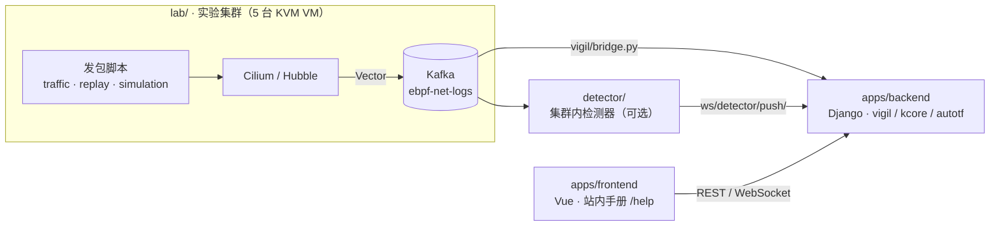
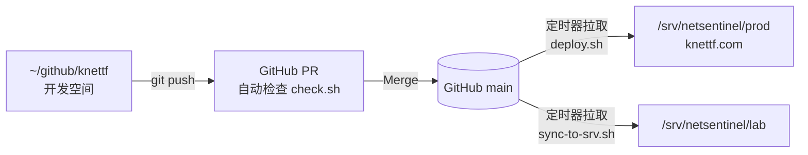

# knettf

**NetSentinel** 网络入侵检测平台，以及配套的 Kubernetes 流量实验环境（lab）。线上地址：https://knettf.com

实验集群用 Cilium/Hubble（eBPF）观测所有网络流量，经 Vector 写入 Kafka；NetSentinel 后端消费 Kafka，按五元组聚合成流特征，交给检测模型（默认 `AdsMLModel`，OCSVM）判断是否为攻击，结果存库并在前端展示。lab 负责搭集群、发正常 / 攻击流量、采集数据集、评估检测效果。

本仓库由原 `NetSentinel`（平台）和 `knetsentinel`（实验环境）两个仓库合并而来，保留了两边的提交历史。



---

## 目录结构

| 目录 | 内容 |
|------|------|
| `apps/backend/` | Django 后端。`vigil`：检测（Kafka 消费、模型、检测记录 API）；`kcore`：用户与集群管理；`autotf`：Terraform 配置扫描；`common`：公共工具 |
| `apps/frontend/` | Vue 3 + Vite 前端，包含站内使用手册（`src/views/help/`，访问 `/help`） |
| `detector/` | 集群内检测器：代码、镜像构建（`build.sh`）、K8s 清单（`k8s/`） |
| `lab/` | 实验环境：集群部署、Kafka / Vector 清单、发包、采集、数据集、检测评估。见 [lab/README.md](lab/README.md) |
| `ops/` | 运维：`deploy/`（systemd、cron、sudoers、cloudflared 配置）、`scripts/deploy.sh`（部署）、`scripts/auto-deploy.sh`（自动部署）、`scripts/check.sh`（检查） |
| `.github/workflows/` | PR 自动检查（GitHub Actions） |
| `docs/` | `structure/` 架构文档与图，`lab/` 实验相关说明（特征定义等），`archive/` 旧资料 |

Python 环境有两套，都用 [uv](https://docs.astral.sh/uv/) 管理：根目录的 `pyproject.toml` 是后端的，`lab/pyproject.toml` 是实验脚本的。

---

## 开发空间与运行空间

| 位置 | 用途 | 怎么更新 |
|------|------|----------|
| `~/github/knettf`（每人自己的 home 下） | **开发空间**：改代码、本地调试、提交、推送 | 本人 |
| `/srv/netsentinel/prod` | **线上平台**（knettf.com），systemd 服务 `netsentinel`，端口 8080 | 自动部署（`deploy.sh`） |
| `/srv/netsentinel/lab` → `lab-repo/lab` | **实验环境运行目录**，数据集、日志、CSV 都在这里 | 自动部署（`lab/sync-to-srv.sh`） |

三处各是一份独立的 Git 检出，各有自己的 `.venv`。开发空间里怎么改都不影响运行空间，代码只能经 **GitHub 上的 `main`** 流到运行空间：



**不要在 `/srv/netsentinel/prod` 或 `/srv/netsentinel/lab` 里改代码**：部署脚本发现运行目录有改动会拒绝更新。数据库、`.env`、模型文件（`/srv/netsentinel/models/`）、数据集只在服务器上，不在 Git 里。

---

## 开始开发

### 1. 克隆仓库，设置提交身份

每人用自己的 Linux 账户和 GitHub 账号（需已加入 `knet-lab` 组织，服务器上配好自己的 GitHub SSH 密钥）：

```bash
git clone git@github.com:knet-lab/knettf.git ~/github/knettf
cd ~/github/knettf
git config user.name  "<GitHub 用户名>"
git config user.email "<GitHub 上已验证的邮箱>"
```

### 2. 准备本地配置

这些文件不在 Git 里，需要自己创建（可参考线上目录里的同名文件，**不要提交**）：

| 文件 | 内容 |
|------|------|
| `apps/backend/backend/.env` | `ENVIRONMENT=linux_development`、`VIGIL_BRIDGE_TOKEN`、`VIGIL_KAFKA_GROUP_ID=vigil-bridge-dev`（避免和线上抢 Kafka 分区）等 |
| `apps/frontend/.env` | `VITE_API_BASE`、`VITE_WS_BASE` |
| `apps/backend/vigil/ml/ads_ml/` | 模型文件（线上在 `/srv/netsentinel/models/ads_ml/`） |

数据库：`default` 是 SQLite（`apps/backend/db.sqlite3`）；`vigil` 是 PostgreSQL，本机 Docker 容器 `pg`（`127.0.0.1:5432`），开发用库 `vigil_dev`，线上用库 `vigil`（同一个容器，注意别连错）。

### 3. 启动

```bash
uv sync                                                        # 后端依赖，生成 .venv
cd apps/backend
../../.venv/bin/python manage.py migrate
../../.venv/bin/python manage.py migrate --database=vigil
../../.venv/bin/python manage.py runserver 8090               # 开发后端 :8090

cd apps/frontend                                               # 另开一个终端
pnpm install
pnpm dev                                                       # 开发前端 :5173，/api、/ws 代理到 :8090
```

开发环境和线上互不干扰：端口不同（8090 / 8080）、`vigil` 库不同、Kafka 消费组不同。

---

## 从改代码到上线

**你只需要：提交 → 推送 → 网页开 PR → 检查通过后合并。之后服务器自动部署，不用登录做任何操作。**

### 分支

`main` 是唯一的长期分支，线上运行的就是它。仓库是公开的，`main` 开启了 GitHub 分支保护：只能通过 PR 合入，禁止直接 push、force push 和删除。

日常开发用**个人分支** `dev/<名字>`（长期保留），也可以一件事临时建一个任务分支（`feat/…`、`fix/…`，合并后删除）。

### 日常流程

```bash
# 1. 开工前，把最新 main 合进自己的分支
git switch dev/<名字>
git pull origin main

# 2. 改代码、提交（可选：本地先跑一遍检查）
git add -A && git commit -m "模块：说明"
ops/scripts/check.sh

# 3. 推送
git push
```

4. 在 GitHub 网页上开 PR：点 **Compare & pull request**，确认 `base: main ← compare: dev/<名字>`，**Create pull request**。
5. PR 页面会自动跑检查（GitHub Actions `check`，约 3 分钟）。✓ 通过后，合并按钮选 **Create a merge commit**（不要选 Squash / Rebase）→ **Merge pull request** → **Confirm merge**。个人分支**不要点 Delete branch**。
6. 等几分钟，自动上线。看进度：`tail -f /srv/netsentinel/logs/auto-deploy.log`

检查没过：在本地修好、提交、`git push`，PR 会自动更新并重新检查。有冲突：本地 `git pull origin main` 解决冲突后再 push。

### 检查 `ops/scripts/check.sh`

PR 上的自动检查和本地运行的是同一个脚本。GitHub Actions 对公开仓库免费。

```bash
ops/scripts/check.sh                     # 全部
ops/scripts/check.sh backend lab         # 只查部分：backend / frontend / lab / detector
```

| 目标 | 内容 |
|------|------|
| `backend` | `uv sync`、`manage.py check`、是否有未生成的迁移、Django 测试 |
| `frontend` | `pnpm install`、`pnpm build`（含类型检查） |
| `lab` | Python、Shell 语法 |
| `detector` | `detector/`、`ops/` 的 Python、Shell 语法 |

只做静态检查和构建，不连 Kafka、不发包、不改线上数据库。

### 自动部署

服务器上的 `netsentinel-autodeploy.timer` 每 2 分钟以 `netsentinel` 账户运行 `ops/scripts/auto-deploy.sh`：

1. 发现 GitHub `main` 有新提交，且该提交的检查全部通过；
2. 按改动路径选择：`apps/backend/`、`pyproject.toml`、`uv.lock` → `deploy.sh -backend`；`apps/frontend/` → `deploy.sh -frontend`；其他（文档、ops）→ `deploy.sh -none`；`lab/` → `sync-to-srv.sh`；
3. `deploy.sh` 拉取 `main`，执行 `uv sync`、`manage.py check`、`collectstatic`、`migrate`（`default` 库）、`pnpm build`，重启 `netsentinel` 并确认 HTTP 200。

注意：

- **`vigil` 库（PostgreSQL）的迁移不会自动执行**（大表改结构可能很慢），日志里会提示，需手动：
  `cd /srv/netsentinel/prod/apps/backend && ../../.venv/bin/python manage.py migrate --database=vigil`
- 检查没通过或部署失败的提交不会上线，也不会反复重试；看日志找原因，修好后合入新的 PR。
- 合入 `main` 就等于上线。要撤回，在自己的分支上 `git revert <提交>` → PR → 合并，同样会自动部署。

---

## 运维

| 要做的事 | 命令 |
|----------|------|
| 线上当前版本 | `git -C /srv/netsentinel/prod log --oneline -1` |
| 自动部署日志 / 下次运行时间 | `tail -f /srv/netsentinel/logs/auto-deploy.log` ／ `systemctl list-timers netsentinel-autodeploy.timer` |
| 服务状态、日志 | `sudo systemctl status netsentinel` ／ `sudo journalctl -u netsentinel -n 200 -f` |
| 重启后端 | `sudo systemctl restart netsentinel` |
| knettf.com 打不开（隧道） | `sudo systemctl status cloudflared-knettf`，必要时 `restart` |
| 手动部署平台 | `/srv/netsentinel/prod/ops/scripts/deploy.sh -backend`（或 `-frontend` / `-all` / `-none`） |
| 手动更新实验环境 | `bash /srv/netsentinel/lab/sync-to-srv.sh`（`-n` 先预览） |
| 立即触发一次自动部署 | `sudo systemctl start netsentinel-autodeploy.service` |

上面的 `sudo` 命令免密码，需要账户在 `netsentinel` 组里（`id` 查看），规则见 `ops/deploy/sudoers.netsentinel`。每天 0 点 cron 运行 `rotate_partitions` 滚动 `vigil` 分区（`ops/deploy/cron.netsentinel`）。

服务器上的部署配置都在 `ops/deploy/`：`netsentinel.service`（平台）、`cloudflared-knettf.service`（隧道）、`netsentinel-autodeploy.{service,timer}`（自动部署，用 `/srv/netsentinel/tools/` 里的 uv 和 node）。改了这些文件需要手动复制到 `/etc/systemd/system/` 并 `sudo systemctl daemon-reload`。

---

## 不进仓库的内容

数据集与 CSV、日志、`.env`、数据库文件、模型文件、`node_modules/`、`dist/`、`.venv/` 都由 `.gitignore`、`lab/.gitignore` 排除。提交前看一眼 `git status`，不要用 `git add -f` 强行加入。仓库是公开的，**不要提交任何密码、token、密钥**。

## 更多文档

- **站内手册** `/help`（中英文）：服务器环境、接手准备、改动上线、后端 / 前端 / 数据库 / 检测模型、实验环境、备份与关机、故障排查
- [lab/README.md](lab/README.md)：实验集群的搭建、网络与 IP 规划、发包与采集脚本
- `docs/structure/`：架构设计文档、数据库结构、模块图
