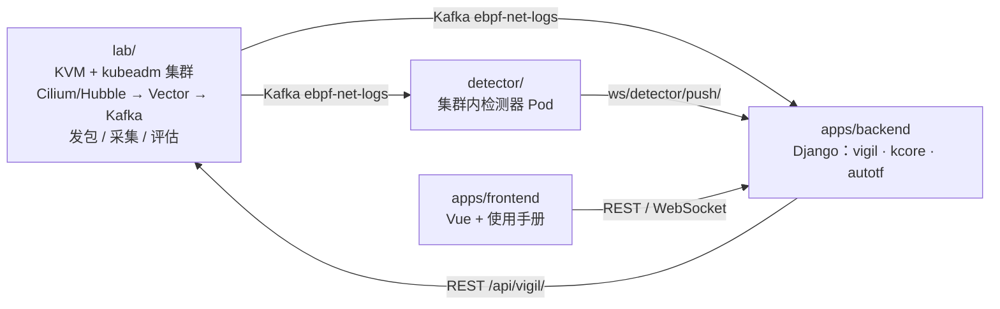

# knettf

NetSentinel 网络入侵检测平台与配套的 Kubernetes 流量实验环境（原 NetSentinel、knetsentinel 两个仓库合并而来，保留了两边的提交历史）。



## 目录

| 目录 | 内容 | 运行位置 |
|------|------|----------|
| `apps/backend/` | Django 后端（`vigil` 检测、`kcore`、`autotf`） | `/srv/netsentinel/prod`（systemd `netsentinel.service`，:8080） |
| `apps/frontend/` | Vue 前端，含站内使用手册（`src/views/help/`） | 构建到 `apps/frontend/dist`，由后端 WhiteNoise 提供 |
| `detector/` | 集群内检测器：代码、镜像（`build.sh`）、K8s 清单（`k8s/`） | 实验集群 `netsentinel` 命名空间 |
| `lab/` | 实验环境：集群部署、Kafka/Vector 清单、发包、采集、数据集、评估。见 [lab/README.md](lab/README.md) | `/srv/netsentinel/lab` |
| `ops/` | 部署运维：`deploy/`（systemd、cron、sudoers、cloudflared）、`scripts/deploy.sh`、`scripts/check.sh` | — |
| `docs/` | 架构文档（`structure/`）、实验说明（`lab/`）、旧资料（`archive/`） | — |

Python 环境有两套，都用 uv 管理：根目录 `pyproject.toml` 是后端的，`lab/pyproject.toml` 是实验脚本的。

## 协作约定

- **GitHub 仓库只放共用的代码和文档**：数据集、CSV、日志、`.env`、模型文件、运行产物都不进仓库（见 `.gitignore`、`lab/.gitignore`）。
- **每人用自己的 Linux 账户和 Git 身份**，在自己的 home 目录里克隆、建个人分支：
  ```bash
  git clone git@github.com:knet-lab/knettf.git ~/github/knettf
  cd ~/github/knettf
  git switch -c <你的分支> origin/merge-dev
  git config user.name  "<GitHub 用户名>"
  git config user.email "<GitHub 已验证邮箱>"
  ```
- **不要在 `/srv/netsentinel/prod` 或 `/srv/netsentinel/lab` 里改代码**，它们只是运行目录。
- 分支：个人分支 → PR 到 `merge-dev`（默认分支）→ `prod`（只快进，用于发布）。

## 本地检查

提交或开 PR 前在自己的检出里运行：

```bash
ops/scripts/check.sh              # 全部
ops/scripts/check.sh backend lab  # 只查部分：backend / frontend / lab / detector
```

内容：后端 `uv sync`、`manage.py check`、未生成的迁移、Django 测试；前端 `pnpm build`；`lab/`、`detector/`、`ops/` 的 Python 和 Shell 语法。不连 Kafka、不发包、不改数据库。

## 发布

- **平台**：PR 合并到 `merge-dev` 后运行服务器上的 `/srv/netsentinel/release.sh -frontend | -backend | -all`，它把 `prod` 快进到 `merge-dev`，再执行 `/srv/netsentinel/prod/ops/scripts/deploy.sh`。
- **实验环境**：在自己的检出里更新到 `merge-dev` 后运行 `bash lab/sync-to-srv.sh`（`-n` 先预览），只同步 Git 跟踪的文件，运行目录里的数据不会被覆盖或删除。

详细步骤见站内手册（`/help`）。
