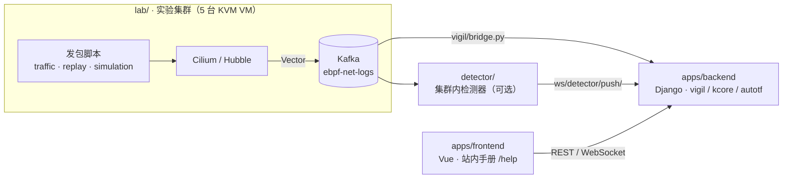

# knettf

**NetSentinel** 网络入侵检测平台，以及配套的 Kubernetes 流量实验环境（lab）。线上地址：https://knettf.com

实验集群用 Cilium/Hubble（eBPF）观测所有网络流量，经 Vector 写入 Kafka；NetSentinel 后端消费 Kafka，按五元组聚合成流特征，交给检测模型（默认 `AdsMLModel`，OCSVM）判断是否为攻击，结果存库并在前端展示。lab 负责搭集群、发正常 / 攻击流量、采集数据集、评估检测效果。

本仓库由原 `NetSentinel`（平台）和 `knetsentinel`（实验环境）两个仓库合并而来，保留了两边的提交历史。



---

## 目录结构

| 目录 | 内容 |
|------|------|
| `apps/backend/` | Django 后端。`vigil`：检测（Kafka 消费、模型、检测记录 API）；`kcore`：用户与集群管理；`autotf`：Terraform 配置扫描；`common`：公共工具 |
| `apps/frontend/` | Vue 3 + Vite 前端，包含站内使用手册（`src/views/help/`，访问 `/help`） |
| `detector/` | 集群内检测器：代码、镜像构建（`build.sh`）、K8s 清单（`k8s/`） |
| `lab/` | 实验环境：集群部署、Kafka / Vector 清单、发包、采集、数据集、检测评估。见 [lab/README.md](lab/README.md) |
| `ops/` | 运维：`deploy/`（systemd、cron、sudoers、cloudflared 配置）、`scripts/deploy.sh`（上线）、`scripts/check.sh`（本地检查） |
| `docs/` | `structure/` 架构文档与图，`lab/` 实验相关说明（特征定义等），`archive/` 旧资料 |

Python 环境有两套，都用 [uv](https://docs.astral.sh/uv/) 管理：根目录的 `pyproject.toml` 是后端的，`lab/pyproject.toml` 是实验脚本的。

---

## 三个目录，各管一件事

| 位置 | 用途 | 谁来改 |
|------|------|--------|
| `~/github/knettf`（每人自己的 home 下） | 开发：改代码、提交、开 PR | 本人 |
| `/srv/netsentinel/prod` | 线上平台（knettf.com），systemd 服务 `netsentinel`，端口 8080 | 只由 `deploy.sh` 更新 |
| `/srv/netsentinel/lab` | 实验脚本的运行目录，数据集、日志、CSV 都在这里 | Git 工作树（`lab-repo/lab` 的软链接），代码只由 `lab/sync-to-srv.sh` 从 GitHub `main` 拉取 |

**不要在 `/srv/netsentinel/prod` 或 `/srv/netsentinel/lab` 里改代码。** 数据库、`.env`、模型文件（`/srv/netsentinel/models/`）、数据集等都不在 Git 里，只在服务器上。

---

## 开始开发

### 1. 克隆仓库，设置提交身份

每人用自己的 Linux 账户和自己的 GitHub 账号（需已加入 `knet-lab` 组织，服务器上配好自己的 GitHub SSH 密钥）：

```bash
git clone git@github.com:knet-lab/knettf.git ~/github/knettf
cd ~/github/knettf
git config user.name  "<GitHub 用户名>"
git config user.email "<GitHub 上已验证的邮箱>"
```

### 2. 准备本地配置

这些文件不在 Git 里，需要自己创建（可参考线上目录里的同名文件，**不要提交**）：

| 文件 | 内容 |
|------|------|
| `apps/backend/backend/.env` | 后端配置：`ENVIRONMENT`、`VIGIL_BRIDGE_TOKEN`、`VIGIL_KAFKA_GROUP_ID`（开发环境用 `vigil-bridge-dev`，避免和线上抢 Kafka 分区）等 |
| `apps/frontend/.env` | `VITE_API_BASE`、`VITE_WS_BASE` |
| `apps/backend/vigil/ml/ads_ml/` | 模型文件（线上在 `/srv/netsentinel/models/ads_ml/`） |

数据库：`default` 是 SQLite（`apps/backend/db.sqlite3`）；`vigil` 是 PostgreSQL，开发时用本机 Docker 容器 `pg`（`127.0.0.1:5432`，库名默认 `vigil_dev`）。

### 3. 启动

```bash
uv sync                                                        # 后端依赖，生成 .venv
cd apps/backend
../../.venv/bin/python manage.py migrate
../../.venv/bin/python manage.py migrate --database=vigil
../../.venv/bin/python manage.py runserver 8090               # 开发后端 :8090

cd apps/frontend                                               # 另开一个终端
pnpm install
pnpm dev                                                       # 开发前端 :5173，/api、/ws 代理到 :8090
```

---

## 分支规则

| 分支 | 规则 |
|------|------|
| `main` | 唯一的长期分支，也是 GitHub 默认分支，线上运行的就是它。**只通过 GitHub 网页 PR 合入**，不直接 push，不 force push。本地 `main` 只用来 `git pull`，不在上面 commit 或 merge |
| 任务分支 `feat/…`、`fix/…`、`docs/…` | 一件事一个分支，从最新 `main` 建；PR 合并后删除（远端和本地） |

仓库是公开仓库，`main` 已开启 GitHub 分支保护（Ruleset）：必须通过 PR 合入，禁止直接 push、force push 和删除。动手前先 `git status`，确认第一行不是 `On branch main`。

## 日常流程

```bash
# 1. 从最新 main 建任务分支
git switch main && git pull origin main
git switch -c feat/简短说明

# 2. 改代码、提交
git add -A && git commit -m "模块：说明"

# 3. 把最新 main 合进任务分支，本地检查（冲突在这里解决）
git switch main && git pull origin main
git switch feat/简短说明 && git merge main
ops/scripts/check.sh

# 4. 推送并开 PR：网页上点 Compare & pull request，确认 base: main ← compare: feat/简短说明，
#    Able to merge → Create pull request →（有其他成员时请对方 Approve）→ Merge pull request → Delete branch
git push -u origin feat/简短说明
#    也可以用 gh：gh pr create --base main --fill  ；  gh pr merge --merge --delete-branch

# 5. 同步本地，删除任务分支
git switch main && git pull origin main
git branch -d feat/简短说明 && git fetch --prune
```

### 本地检查 `ops/scripts/check.sh`

```bash
ops/scripts/check.sh                     # 全部
ops/scripts/check.sh backend lab         # 只查部分：backend / frontend / lab / detector
```

| 目标 | 内容 |
|------|------|
| `backend` | `uv sync`、`manage.py check`、是否有未生成的迁移、Django 测试（约 4 分钟） |
| `frontend` | `pnpm install`、`pnpm build`（含类型检查） |
| `lab` | Python、Shell 语法 |
| `detector` | `detector/`、`ops/` 的 Python、Shell 语法 |

只做静态检查和构建，不连 Kafka、不发包、不改数据库。最后输出 `✓ 全部通过` 才开 PR。

---

## 上线（自动）

**PR 合入 `main` 后不用手动操作。** 流程：

1. 每个 PR 和 `main` 的每次提交都由 GitHub Actions（`.github/workflows/check.yml`）跑 `ops/scripts/check.sh`，结果显示在 PR 页面上。
2. 服务器上的 `netsentinel-autodeploy.timer` 每 2 分钟运行 `ops/scripts/auto-deploy.sh`（`netsentinel` 账户）：发现 `main` 有新提交、且该提交的检查全部通过后，按改动路径自动执行下面的 `deploy.sh -backend` / `-frontend` / `-none` 和 `sync-to-srv.sh`。
3. 合并后约 5～10 分钟上线（等检查跑完 + 下一轮定时器）。

```bash
tail -f /srv/netsentinel/logs/auto-deploy.log            # 部署日志
systemctl list-timers netsentinel-autodeploy.timer         # 下次运行时间
```

- 检查没通过或部署失败的提交不会上线，也不会反复重试；日志里有原因，修好后合入新的 PR 即可。
- `vigil` 库（PostgreSQL）的迁移**仍需手动执行**，日志里会提示。
- 安装（只需一次，需 sudo）：`sudo cp ops/deploy/systemd/netsentinel-autodeploy.{service,timer} /etc/systemd/system/ && sudo systemctl daemon-reload && sudo systemctl enable --now netsentinel-autodeploy.timer`。它用 `/srv/netsentinel/tools/` 里的 uv 和 node。

下面两个脚本是自动部署调用的，也可以手动运行（例如自动部署失败后排查）。

**平台**（手动，账户需在 `netsentinel` 组里）：

```bash
/srv/netsentinel/prod/ops/scripts/deploy.sh -frontend    # 或 -backend / -all / -none
```

它在 `/srv/netsentinel/prod` 里 `git pull --ff-only` 到最新 `main`，然后按参数执行 `uv sync`、`manage.py check`、`collectstatic`、`migrate`（只迁移 `default` 库；`vigil` 库有未执行的迁移时只提示，需手动执行）、`pnpm build`，重启 `netsentinel` 并确认返回 HTTP 200。

- 线上当前版本：`git -C /srv/netsentinel/prod log --oneline -1`
- 回退：新建任务分支 `git revert <提交>` → PR → 部署

**实验环境**（手动）：

```bash
bash /srv/netsentinel/lab/sync-to-srv.sh -n    # 先看会更新哪些提交
bash /srv/netsentinel/lab/sync-to-srv.sh
```

它在运行目录里 `git pull --ff-only` GitHub 上的 `main`，与你本地检出哪个分支无关；运行目录里有已跟踪文件被改过时拒绝更新。数据、`.env`、`.venv`、日志被 Git 忽略，不会被动到。

---

## 不进仓库的内容

数据集与 CSV、日志、`.env`、数据库文件、模型文件、`node_modules/`、`dist/`、`.venv/` 都由 `.gitignore`、`lab/.gitignore` 排除。提交前看一眼 `git status`，不要用 `git add -f` 强行加入。

## 更多文档

- **站内手册** `/help`（中英文）：服务器环境、接手准备、改动上线、后端 / 前端 / 数据库 / 检测模型、实验环境、备份与关机、故障排查
- [lab/README.md](lab/README.md)：实验集群的搭建、网络与 IP 规划、发包与采集脚本
- `docs/structure/`：架构设计文档、数据库结构、模块图
