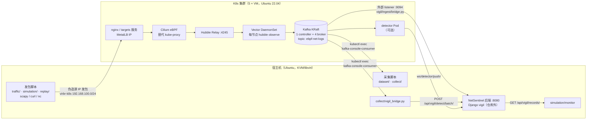

# lab — 实验环境（原 knetsentinel）

基于 **KVM + kubeadm + Cilium/Hubble (eBPF) + Vector + Kafka** 的 Kubernetes 网络流量采集与入侵检测实验环境。

在单台宿主机上用 libvirt 起 5 台 VM 组成 K8s 集群，Cilium 以 eBPF 方式观测所有流量，Hubble 流事件经 Vector 写入 Kafka；宿主机通过绑定伪造源 IP 向集群发送正常 / 攻击流量，用于：

- 采集带标签的数据集（包级 → 流级 30 特征）
- 把流量实时送到 NetSentinel 检测后端（Django `vigil` 应用，模型由 `VIGIL_MODELS` 配置，默认 `AdsMLModel`/OCSVM）并评估检测效果

> 本目录是 knettf 仓库的 `lab/` 部分，有独立的 Python 环境（`lab/pyproject.toml`，只用 **uv** 管理）。下文路径除特别说明外都相对 `lab/`。
> 运行目录：`/srv/netsentinel/lab`（软链接到 `/srv/netsentinel/lab-repo/lab`，一个只检出 `lab/` 的 Git 工作树，由 `lab/sync-to-srv.sh` 拉取 GitHub `main`；数据只放在那里）。

---

## 1. 整体架构



数据流：`数据包 → Cilium eBPF → Hubble → Vector(exec hubble observe --output=json) → Kafka ebpf-net-logs → 采集脚本 / 检测器`

---

## 2. 技术栈与版本

| 层 | 组件 | 版本 / 说明 |
|----|------|-------------|
| 虚拟化 | KVM + libvirt + virt-install + cloud-init | Ubuntu 22.04 (jammy) cloud image |
| 容器运行时 | containerd | `SystemdCgroup = true` |
| K8s | kubeadm / kubelet / kubectl | v1.28（pkgs.k8s.io），跳过 kube-proxy |
| CNI / 观测 | Cilium + Hubble（Helm） | `kubeProxyReplacement=true`，Hubble Relay + UI，`mtu=1450` |
| 负载均衡 | MetalLB（Helm，L2 模式） | IP 池 `192.168.100.200-250` |
| 存储 | rancher local-path-provisioner | v0.0.28，设为默认 StorageClass |
| 日志管道 | Vector DaemonSet | `timberio/vector:0.38.0-distroless-libc`，hubble CLI `v0.13.0` |
| 消息队列 | Apache Kafka（KRaft，无 ZooKeeper） | `apache/kafka:4.0.2` |
| Python | uv + Python 3.12 | scapy 2.7.0、confluent-kafka 2.13.2、python-dotenv、aiohttp、websockets |

---

## 3. 网络与 IP 规划

| 地址 | 用途 |
|------|------|
| `192.168.100.1` | 宿主机在 `virbr-k8s` 网桥上的地址（NAT 出网，宿主机出口网卡 `enp6s0`） |
| `192.168.100.10` | k8s-master（control-plane，120G 磁盘） |
| `192.168.100.11-14` | k8s-node1 ~ node4（60G 磁盘），每台 2 vCPU / 8G 内存 |
| `192.168.100.16-29` | 伪造攻击源 IP（`spoof_attack.py` 用 `.20-.29`，标签 1） |
| `192.168.100.50-64` | 正常流量源 IP（标签 0）；`.50-.99` 同时也是 libvirt DHCP 动态段 |
| `192.168.100.170-184` | `simulation/` 攻击源 IP |
| `192.168.100.200-203` | Kafka broker-0~3 外部地址（`:9094`，MetalLB） |
| `192.168.100.204` | `my-nginx` 测试服务（MetalLB 分配，以实际为准） |
| `192.168.100.210-214` | `targets` 命名空间靶机（固定 MetalLB IP，见 4.4） |
| `10.244.0.0/16` | Pod CIDR |

VM IP 通过 **libvirt DHCP 的 MAC→IP 绑定** 固定（MAC `52:54:00:1X:00:01`），不使用 netplan 静态 IP。

发包脚本把上述源 IP 临时 `ip addr add` 到 `virbr-k8s`，使数据包与 VM 处于同一二层，Hubble 能看到原始源 IP；脚本结束时自动删除。

---

## 4. 环境搭建

### 4.0 宿主机要求

- Linux + KVM（`/dev/kvm` 可用），用户可 sudo
- `/home/vm-images` 所在分区可用空间 **≥ 420GB**
- 宿主机能访问外网（下载 cloud image、apt 源、Helm chart、镜像）
- 已安装 `kubectl`；`helm` 缺失时脚本会自动安装
- 若宿主机出口网卡不是 `enp6s0`，修改 `cluster/02-setup-cluster.sh` 中的 `HOST_NIC`

脚本里的绝对路径统一为 `/srv/netsentinel/lab`（仓库）和 `/home/vm-images`（VM 磁盘），换目录时需要一并修改。

### 4.1 一键部署流程（`cluster/`）

脚本均为幂等设计，失败修复后可直接重跑。

```bash
cd cluster

bash 00-clear.sh          # 可选：彻底清理旧环境（VM、网桥、磁盘、cloud image、kubeconfig、/etc/hosts）
bash 01-setup-vms.sh      # 创建网桥 + 5 台 VM，等待 SSH 就绪
bash 02-setup-cluster.sh  # 安装 K8s 及集群基础组件
bash 03-deploy-5nodes.sh  # 部署 Kafka + Vector + nginx，并回写本地配置
```

**01-setup-vms.sh**

1. 安装 `virtinst qemu-utils genisoimage wget`，启动 libvirtd，把当前用户加入 `libvirt`/`kvm` 组
2. 创建 NAT 网桥 `virbr-k8s`（含 DHCP MAC→IP 绑定）
3. 下载 Ubuntu 22.04 cloud image，为每台 VM 创建 qcow2 差量盘
4. 生成 cloud-init ISO：用户 `k8s`（免密 sudo，注入 `~/.ssh/id_rsa.pub`）、关 swap、关 ufw、扩容根分区
5. `virt-install` 启动 VM，轮询 SSH，超时会自动诊断（VM 状态、DHCP 租约、ping、ssh -v）

**02-setup-cluster.sh**

1. 宿主机开启 `ip_forward`，补齐 MASQUERADE / FORWARD 规则
2. 所有节点：关 swap、加载 `overlay`/`br_netfilter`、sysctl、安装 containerd 与 kubeadm/kubelet/kubectl v1.28
3. `kubeadm init --pod-network-cidr=10.244.0.0/16 --skip-phases=addon/kube-proxy`
4. kubeconfig 拷到宿主机 `~/.kube/config`（server 指向 `192.168.100.10:6443`），worker 节点 join
5. Helm 安装 Cilium + Hubble，`hubble-relay` Service 端口统一为 **4245**
6. Helm 安装 MetalLB 并配置 `IPAddressPool` + `L2Advertisement`
7. 安装 local-path-provisioner，设为默认 StorageClass（Kafka PVC 依赖）

**03-deploy-5nodes.sh**

1. 前置检查：5 节点 Ready、local-path、MetalLB、hubble-relay
2. 先只 apply `manifests/kafka-5nodes.yaml` 中的 Service，等 MetalLB 分配 `kafka-{0..3}-external` IP
3. 用真实 IP 创建 ConfigMap `kafka-node-ips`，再 apply 完整 Kafka 清单，等 controller 与 4 个 broker 就绪
4. 创建 Secret `vector-kafka-secret`（`kafka-svc.default.svc.cluster.local:9092`），部署 `manifests/vector-5nodes.yaml`
5. 部署 `my-nginx`（LoadBalancer:80）作为测试目标
6. 后台 `kubectl port-forward svc/hubble-relay 4245`（日志 `/tmp/hubble-pf.log`）
7. 在 `/etc/hosts` 写入 `kafka-svc.default.svc.cluster.local`，并重写 `lab/.env`

### 4.2 Kafka 部署要点（`manifests/kafka-5nodes.yaml`）

- **KRaft 模式**，固定 cluster id `MkU3OEVBNTcwNTJENDM2Qg`
- `kafka-controller`：单个 Pod，固定在 k8s-master（容忍 control-plane taint），`process.roles=controller`，监听 9093，数据用 emptyDir
- `kafka-broker`：StatefulSet × 4，Pod 反亲和分布在 node1~4，`process.roles=broker`，`node.id = 序号 + 1`
  - listener：`PLAINTEXT:9092`（集群内，经 `kafka-headless`）、`EXTERNAL:9094`（集群外，MetalLB IP，由 initContainer 从 `kafka-node-ips` 读出后写入 `advertised.listeners`）
  - 副本因子 3，`min.insync.replicas=2`，保留 24h / 1GiB，允许自动建 topic
  - 每个 broker 一个 10Gi PVC（local-path）
- Service：`kafka-svc`（集群内 bootstrap :9092）、`kafka-headless`、`kafka-controller-svc`、`kafka-{0..3}-external`（`externalTrafficPolicy: Local`）

### 4.3 Vector 管道（`manifests/vector-5nodes.yaml`）

- initContainer 从 `quay.io/cilium/hubble:v0.13.0` 拷出 hubble 二进制
- `source`：`exec` 流式运行 `hubble observe --follow --output=json --server=hubble-relay.kube-system.svc.cluster.local:4245`，退出后 5s 重启
- `transform`：`parse_json` 解析，失败丢弃
- `sink`：Kafka topic `ebpf-net-logs`，JSON 编码，批量 500 条 / 1s，内存缓冲 50000，满了丢最新
- `manifests/vector.yaml` 是早期 minikube 版本

### 4.4 可选组件（需手动 apply）

```bash
# 主机防火墙可见性策略：允许集群内部、192.168.100.0/24、Pod CIDR 入站，让 host endpoint 流量也被 Hubble 记录
kubectl apply -f cluster/host-firewall-ccnp.yaml

# simulation/ 使用的靶机服务（namespace: targets，DaemonSet + 固定 MetalLB IP）
kubectl apply -f cluster/targets.yaml
```

| 服务 | IP:端口 | 镜像 |
|------|---------|------|
| http-api | 192.168.100.210:8080/TCP | hashicorp/http-echo |
| mysql-sim | 192.168.100.211:3306/TCP | alpine:3.19 |
| ftp-sim | 192.168.100.212:21/TCP | alpine:3.19 |
| udp-echo | 192.168.100.213:9999/UDP | alpine:3.19 |
| dns-sim | 192.168.100.214:53/UDP | alpine:3.19 |

其他：

- `../detector/k8s/detector-deployment.yaml`：在 `netsentinel` 命名空间部署 `soar009/netsentinel-detector`，消费 `ebpf-net-logs`，结果经 WebSocket 推到 `ws://knettf.com:8080/ws/detector/push/`（`knettf.com` 通过 hostAliases 指向宿主机 `192.168.100.1`）。需先创建 Secret `detector-secret`（key `django-token`）
- `cluster/my-nginx-ingress.yaml`：my-nginx 的 Ingress（需要 nginx ingress controller）

### 4.5 部署验证

```bash
kubectl get node -o wide
kubectl get pods -A

# Hubble 实时流量
hubble observe --follow --server localhost:4245

# Kafka broker 连通
kubectl exec -n default kafka-broker-0 -- /opt/kafka/bin/kafka-broker-api-versions.sh \
  --bootstrap-server kafka-svc.default.svc.cluster.local:9092

# topic 中有数据
kubectl exec -n default kafka-broker-0 -- /opt/kafka/bin/kafka-console-consumer.sh \
  --bootstrap-server kafka-svc.default.svc.cluster.local:9092 \
  --topic ebpf-net-logs --from-beginning --max-messages 5

# Vector 日志
kubectl logs -n kube-system -l app=vector --tail=50

# 宿主机环境诊断（磁盘、网桥、DHCP 租约、NAT、KVM）
bash cluster/host-info.sh
```

---

## 5. Python 环境

```bash
curl -LsSf https://astral.sh/uv/install.sh | sh   # 安装 uv
uv sync                                           # 按 uv.lock 创建 .venv（Python 3.12）
uv run python <script.py>
```

- 依赖声明在 `pyproject.toml`，`requirements.txt` 只是旧的子集，不再维护
- 发包脚本需要 root（`ip addr add` + raw socket），用 `sudo .venv/bin/python3 ...` 或 `sudo $(which uv) run ...`
- 采集脚本以普通用户运行即可，它们通过 `kubectl exec kafka-broker-0 -- kafka-console-consumer.sh` 读 Kafka，依赖本机 kubeconfig，**不直接连 Kafka 外部端口**
- `collect/vigil_bridge.py` 用到 `requests`，`simulation/monitor/monitor.py` 只用标准库；`requests` 不在 `pyproject.toml` 中

### `.env`

由 `03-deploy-5nodes.sh` 自动生成，供直接连 Kafka 外部 listener 的客户端使用：

```ini
BOOTSTRAP_SERVERS=192.168.100.200:9094,192.168.100.201:9094,192.168.100.202:9094,192.168.100.203:9094
GROUP_ID=ebpf-log-consumer-group
AUTO_OFFSET_RESET=earliest
TOPICS='["ebpf-net-logs"]'
```

---

## 6. 目录说明与使用

```
lab/
├── cluster/      # ★ 集群部署脚本 00~03 + host-info.sh；targets.yaml、host-firewall-ccnp.yaml、my-nginx-ingress.yaml
├── manifests/    # Kafka KRaft、Vector DaemonSet 清单
├── traffic/      # 基础发包脚本
├── dataset/      # 数据集采集与流聚合
├── collect/      # Kafka 读取、过滤、推送到检测后端；last_record.sh 取最后一条 hubble 事件
├── replay/       # CSV 流量重放 + 采集流水线（有独立 README）
├── simulation/   # 端到端检测效果评估
└── sync-to-srv.sh
```

检测器的 K8s 清单在仓库的 `detector/k8s/`，特征说明等文档在 `docs/lab/`。

### 6.1 `traffic/` — 发包

| 脚本 | 作用 |
|------|------|
| `send_request.py` | 从 `.50-.64` 用 curl 请求 nginx（`192.168.100.204:80`）；`--repeat N --delay S` |
| `send_normal_scapy.py` | 从 `.50-.64` 向 5 个节点发混合协议正常流量（HTTP/HTTPS/SSH/kube-api SYN、DNS/NTP/syslog UDP、ICMP）；`--packets N` |
| `spoof_attack.py` | 从 `.20-.29` 向 5 个节点发 SYN flood（master:6443，worker:80）；`--packets N` |
| `handle_addr.py` | 批量添加/删除 `.16-.29` 到 `virbr-k8s`：`--action add|delete` |
| `run_traffic_only.sh` | 只发正常 + 攻击流量、不采集，配合手动启动的 `dataset_collector.py` 使用；`--normal-repeat N --attack-packets N` |

### 6.2 `dataset/` — 数据集

```bash
sudo bash dataset/run_dataset_collection.sh [输出.csv]
```

编排：后台启动 `dataset_collector.py`（普通用户）→ 发正常流量 → 发攻击流量 → 等 20s 排水 → 停止。默认目标 160000 条攻击、50000 条正常。

- `dataset_collector.py`：按源 IP 打标签（`.20-.29`→1，`.50-.64`→0，其余丢弃），输出包级 CSV：`timestamp, verdict, direction, summary, src_ip, dst_ip, protocol, src_port, dst_port, tcp_flags, is_reply, trace_reason, label`
- `aggregate_flows.py -i dataset.csv -o flows.csv -t 5`：按五元组 + 超时窗口聚合成 **30 个流级特征**（时长、包数/速率、IAT 统计、TCP 标志计数与比例、回包比例、放行/丢弃统计），详见 [docs/lab/features.md](../docs/lab/features.md)

### 6.3 `collect/` — 读取与推送

```bash
python3 collect/kafka_read.py --protocol TCP --src 192.168.100.2 --from-beginning   # 过滤打印
bash collect/run_kafka_read.sh       # 全量读取 → kafka_read_result.log
bash collect/run_spoof_capture.sh    # 只抓 .20-.29 的 TCP → spoof_attack_captured.log
python3 collect/kafka_read_csv.py --output dataset.csv --max-attack 160000 --max-normal 50000
```

`kafka_read.py` 的过滤参数：`--verdict --direction --protocol --src --dst --src-ns --dst-ns --src-pod --dst-pod --node --drop-only -n`，详见 [docs/lab/kafka_read.md](../docs/lab/kafka_read.md)。

**`vigil_bridge.py`**：消费 `ebpf-net-logs`，在内存中按五元组聚合为 30 特征流记录，批量 POST 到 NetSentinel 的 `/api/vigil/detect/batch/`：

```bash
uv run python collect/vigil_bridge.py --backend http://localhost:8080 --token <JWT> \
  --window 5 --batch-size 20 [--from-beginning]
```

### 6.4 `replay/` — CSV 流量重放

把外部数据集（`test set_20000(1).csv`，约 2 万条 flow）通过 `ip_mapping.json` 映射到测试环境 IP（源 `.50-.64`，目标 `.10-.14`），用 scapy 逐 flow 重放，同时从 Kafka 采集结果：

```bash
sudo bash replay/scripts/start_send.sh [--max-packets N]   # 后台发包，写 send.pid / send.done
bash replay/scripts/start_read.sh                          # 等 send.pid 出现后开始采集，send.done 后再排水 15s 退出
uv run replay/scripts/aggregate.py --window 10000          # 每 N 行汇总统计
```

产物：`record_send_uuid.txt`（每条 flow 的发送记录，JSONL）、`read_result.csv`。详见 [replay/README.md](replay/README.md)。

### 6.5 `simulation/` — 端到端检测评估

需要先启动 NetSentinel 后端（`localhost:8080`），准备一个后端 JWT access token，并部署 4.4 中的 `targets` 靶机。

```bash
sudo NETSENTINEL_TOKEN=<JWT> bash simulation/run.sh [1|2|3]
# 后端不在 localhost:8080 时再加 NETSENTINEL_BACKEND=http://host:port
```

| 模式 | 脚本 | 内容 |
|------|------|------|
| 1 | `simulate_1.py` | 纯正常流量（源 `.50-.59`，HTTP/TCP/UDP，90s） |
| 2 | `simulate_2.py` | 正常 + 攻击混合（攻击源 `.170-.184`） |
| 3 | `simulate_3.py` | 纯攻击，9 类：DoS / DDoS TCP SYN flood、TCP sequence prediction、DoS Get、Slowloris、Slow-body、Slow-read、Slow-range、Credentials hijacking |

`run.sh` 先启动 `monitor/monitor.py`，再运行 simulate 脚本。monitor 每秒轮询一次 `GET /api/vigil/records/?time_from=<启动时间>`（JWT 认证），收集启动后落库的检测记录；simulate 每发一条输出一行 `SEND|group|src|dst|port|type|ts` 到 `monitor/send.log`，monitor 将其与检测记录对齐，simulate 停发 5s 后再拉一次并生成 `monitor_report_<mode>.txt`（混淆矩阵、Accuracy/Precision/Recall/F1、攻击类型分布）和 `monitor_detail_<mode>.csv`。

`simulate_4.py` 跳过 Kafka/bridge，直接 `django.setup()` 导入 NetSentinel 后端的 `vigil.services`（默认取同一仓库的 `apps/backend`；在运行目录 `/srv/netsentinel/lab` 里运行时用环境变量 `NETSENTINEL_BACKEND_DIR` 指定，例如 `/srv/netsentinel/prod/apps/backend`），把 `simulate4.csv`（由 `gen_simulate4_csv.py` 将特征 CSV 与 `20000_test_attack_label.csv` 合并生成）的预聚合流特征批量送入模型。

---

## 7. 外部依赖

检测模型与后端在同一仓库的 `apps/backend/`（Django 项目，`vigil` 应用），生产实例运行在 `:8080`。`lab/` 只负责环境、流量生成、采集和评估。

本仓库用到的后端接口：

| 接口 | 使用方 |
|------|--------|
| `POST /api/vigil/detect/batch/`（JWT） | `collect/vigil_bridge.py` |
| `GET /api/vigil/records/`（JWT，支持 `time_from`/`limit`/`offset`） | `simulation/monitor/monitor.py` |
| `ws/detector/push/`（Bearer = 后端 `VIGIL_BRIDGE_TOKEN`） | `../detector/k8s/detector-deployment.yaml` 中的检测器 Pod |
| Python 模块 `vigil.services` | `simulation/simulate_4.py` |

后端已不再提供 `ws/vigil/` WebSocket 推送（NetSentinel 原仓库提交 bf011ca 删除），检测结果只能从数据库 / `records` 接口读取。

后端相关配置（`apps/backend/backend/settings.py`，可用环境变量覆盖）：

- `VIGIL_MODELS`：要加载的模型类列表，默认 `vigil.detection.ads_ml.AdsMLModel`
- `VIGIL_ADS_ML_CONFIG`：AdsMLModel 的配置文件，默认 `/srv/netsentinel/models/ads_ml/current/config.yaml`；模型目录在启动时解析软链接，切换版本需重启后端
- `VIGIL_KAFKA_GROUP_ID`：后端自带的 Kafka 消费桥（`vigil/ingest/bridge.py`，随后端启动）使用的 consumer group，默认 `vigil-bridge`
- `VIGIL_BRIDGE_TOKEN`：`ws/detector/push/` 的认证 token

---

## 8. 常见问题

| 现象 | 排查 |
|------|------|
| VM SSH 超时 | 01 脚本会自动诊断；检查 `virsh net-dhcp-leases virbr-k8s` 是否拿到绑定的 IP |
| VM 无法出网 | 检查 `HOST_NIC` 是否为实际出口网卡，`iptables -t nat -L -n \| grep 192.168.100` |
| MetalLB 不分配 IP | `kubectl get pods -n metallb-system`；apply IP 池过早会被 webhook 拒绝，重跑 02 即可 |
| Kafka broker 起不来 | ConfigMap `kafka-node-ips` 是否在 broker 前创建；`kubectl logs kafka-controller` |
| Kafka 无数据 | `kubectl logs -n kube-system -l app=vector`；确认 hubble-relay Service 端口为 4245 |
| Hubble 看不到伪造源 IP 的流量 | 源 IP 是否已绑定到 `virbr-k8s`；必要时 apply `host-firewall-ccnp.yaml` |
| 发包报权限错误 | 发包脚本需要 root |

注意：重新部署后若 nginx 的 MetalLB IP 变了，`03-deploy-5nodes.sh` Step 12 会提示，需要手动更新 `traffic/send_request.py` 中的 `DESTINATION_IP`。

---

## 9. 版本管理与运行目录

代码在 knettf 仓库的 `lab/` 下，用 Git 管理；运行时的数据只放在运行目录 `/srv/netsentinel/lab`，不进仓库。

- 改代码：在自己的仓库检出里改 `lab/`，提交、合并到 `main`
- 更新运行目录：PR 合入 main 后由自动部署完成；手动：`bash /srv/netsentinel/lab/sync-to-srv.sh`（`git pull --ff-only` GitHub `main`；`-n` 预览；有本地改动时拒绝更新；不会动被忽略的数据、`.env`、`.venv`）
- 运行目录初始化（只需一次，已完成）：
  ```bash
  git clone --filter=blob:none --sparse https://github.com/knet-lab/knettf.git /srv/netsentinel/lab-repo
  git -C /srv/netsentinel/lab-repo sparse-checkout set lab
  git -C /srv/netsentinel/lab-repo config core.sharedRepository group
  ln -s lab-repo/lab /srv/netsentinel/lab
  ```
- `lab/.gitignore` 排除：`*.csv`、`*.log`、`*.pid`、`*.done`、`logs/`、`.env`、`.venv/`、`replay/record_send_uuid.txt`、`simulation/monitor/monitor_report_*.txt`

`replay/scripts/start_send.sh`、`start_read.sh` 在 `PATH` 中找不到 `uv` 时会回退到写死的 `/home/soar009/.local/bin/uv`，换用户运行时需确保 `uv` 在 `PATH` 中。
