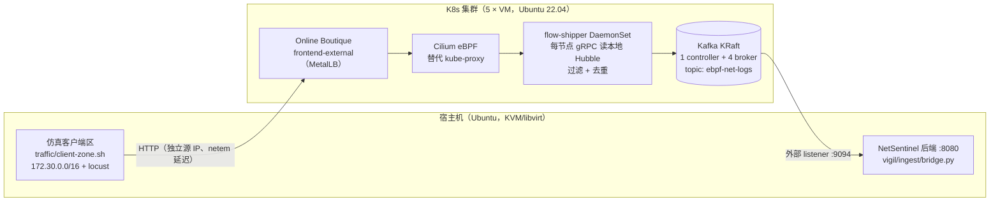

# lab — 实验环境（原 knetsentinel）

基于 **KVM + kubeadm + Cilium/Hubble (eBPF) + flow-shipper + Kafka** 的 Kubernetes 网络流量采集与入侵检测实验环境。

在单台宿主机上用 libvirt 起 5 台 VM 组成 K8s 集群，Cilium 以 eBPF 方式观测所有流量，Hubble 流事件经 flow-shipper 写入 Kafka；宿主机通过绑定伪造源 IP 向集群发送正常 / 攻击流量，用于：

- 采集带标签的数据集（包级 → 流级 30 特征）
- 把流量实时送到 NetSentinel 检测后端（Django `vigil` 应用，模型由 `VIGIL_MODELS` 配置，默认 `AdsMLModel`/OCSVM）并评估检测效果

> 本目录是 knettf 仓库的 `lab/` 部分，有独立的 Python 环境（`lab/pyproject.toml`，只用 **uv** 管理）。下文路径除特别说明外都相对 `lab/`。
> 运行目录：`/srv/netsentinel/lab`（软链接到 `/srv/netsentinel/lab-repo/lab`，一个只检出 `lab/` 的 Git 工作树，由 `lab/sync-to-srv.sh` 拉取 GitHub `main`；数据只放在那里）。

---

## 1. 整体架构



数据流：`数据包 → Cilium eBPF → Hubble → flow-shipper(gRPC 读本节点 Hubble，过滤 + 去重) → Kafka ebpf-net-logs → 平台后端拼流 + 检测`

---

## 2. 技术栈与版本

| 层 | 组件 | 版本 / 说明 |
|----|------|-------------|
| 虚拟化 | KVM + libvirt + virt-install + cloud-init | Ubuntu 22.04 (jammy) cloud image |
| 容器运行时 | containerd | `SystemdCgroup = true` |
| K8s | kubeadm / kubelet / kubectl | v1.28（pkgs.k8s.io），跳过 kube-proxy |
| CNI / 观测 | Cilium + Hubble（Helm） | `kubeProxyReplacement=true`，Hubble Relay + UI，`mtu=1450` |
| 负载均衡 | MetalLB（Helm，L2 模式） | IP 池 `192.168.100.200-250` |
| 存储 | rancher local-path-provisioner | v0.0.28，设为默认 StorageClass |
| 日志管道 | flow-shipper DaemonSet（`lab/shipper/`） | `python:3.12.11-slim`，依赖启动时 pip 安装：grpcio 1.71.0、protobuf 5.29.5、confluent-kafka 2.13.2 |
| 消息队列 | Apache Kafka（KRaft，无 ZooKeeper） | `apache/kafka:4.0.2` |
| Python | uv + Python 3.12 | scapy 2.7.0、confluent-kafka 2.13.2、python-dotenv、aiohttp、websockets |

---

## 3. 网络与 IP 规划

| 地址 | 用途 |
|------|------|
| `192.168.100.1` | 宿主机在 `virbr-k8s` 网桥上的地址（NAT 出网，宿主机出口网卡 `enp6s0`） |
| `192.168.100.10` | k8s-master（control-plane，120G 磁盘） |
| `192.168.100.11-14` | k8s-node1 ~ node4（60G 磁盘），每台 9 vCPU / 12G 内存（master 6 vCPU / 16G；VM 合计 42 核，宿主机留 14 核） |
| `192.168.100.20-29` | 攻击源 IP 段（平台自动打标签 1） |
| `192.168.100.50-64` | 正常流量源 IP 段（标签 0）；`.50-.99` 同时也是 libvirt DHCP 动态段 |
| `192.168.100.200-203` | Kafka broker-0~3 外部地址（`:9094`，MetalLB） |
| `192.168.100.204-205` | `my-nginx`、Online Boutique `frontend-external`（MetalLB 分配，以实际为准） |
| `172.30.0.0/16` | 宿主机仿真客户端区（`traffic/client-zone.sh`） |
| `10.244.0.0/16` | Pod CIDR |

VM IP 通过 **libvirt DHCP 的 MAC→IP 绑定** 固定（MAC `52:54:00:1X:00:01`），不使用 netplan 静态 IP。

---

## 4. 环境搭建

### 4.0 宿主机要求

- Linux + KVM（`/dev/kvm` 可用），用户可 sudo
- `/home/vm-images` 所在分区可用空间 **≥ 420GB**
- 宿主机能访问外网（下载 cloud image、apt 源、Helm chart、镜像）
- 已安装 `kubectl`；`helm` 缺失时脚本会自动安装
- 若宿主机出口网卡不是 `enp6s0`，修改 `cluster/02-setup-cluster.sh` 中的 `HOST_NIC`

脚本里的绝对路径统一为 `/srv/netsentinel/lab`（仓库）和 `/home/vm-images`（VM 磁盘），换目录时需要一并修改。

### 4.1 一键部署流程（`cluster/`）

脚本均为幂等设计，失败修复后可直接重跑。

```bash
cd cluster

bash 00-clear.sh          # 可选：彻底清理旧环境（VM、网桥、磁盘、cloud image、kubeconfig、/etc/hosts）
bash 01-setup-vms.sh      # 创建网桥 + 5 台 VM，等待 SSH 就绪
bash 02-setup-cluster.sh  # 安装 K8s 及集群基础组件
bash 03-deploy-5nodes.sh  # 部署 Kafka + flow-shipper + nginx，并回写本地配置
```

**01-setup-vms.sh**

1. 安装 `virtinst qemu-utils genisoimage wget`，启动 libvirtd，把当前用户加入 `libvirt`/`kvm` 组
2. 创建 NAT 网桥 `virbr-k8s`（含 DHCP MAC→IP 绑定）
3. 下载 Ubuntu 22.04 cloud image，为每台 VM 创建 qcow2 差量盘
4. 生成 cloud-init ISO：用户 `k8s`（免密 sudo，注入 `~/.ssh/id_rsa.pub`）、关 swap、关 ufw、扩容根分区
5. `virt-install` 启动 VM，轮询 SSH，超时会自动诊断（VM 状态、DHCP 租约、ping、ssh -v）

**02-setup-cluster.sh**

1. 宿主机开启 `ip_forward`，补齐 MASQUERADE / FORWARD 规则
2. 所有节点：关 swap、加载 `overlay`/`br_netfilter`、sysctl、安装 containerd 与 kubeadm/kubelet/kubectl v1.28
3. `kubeadm init --pod-network-cidr=10.244.0.0/16 --skip-phases=addon/kube-proxy`
4. kubeconfig 拷到宿主机 `~/.kube/config`（server 指向 `192.168.100.10:6443`），worker 节点 join
5. Helm 安装 Cilium + Hubble，`hubble-relay` Service 端口统一为 **4245**
6. Helm 安装 MetalLB 并配置 `IPAddressPool` + `L2Advertisement`
7. 安装 local-path-provisioner，设为默认 StorageClass（Kafka PVC 依赖）

**03-deploy-5nodes.sh**

1. 前置检查：5 节点 Ready、local-path、MetalLB、hubble-relay
2. 先只 apply `manifests/kafka-5nodes.yaml` 中的 Service，等 MetalLB 分配 `kafka-{0..3}-external` IP
3. 用真实 IP 创建 ConfigMap `kafka-node-ips`，再 apply 完整 Kafka 清单，等 controller 与 4 个 broker 就绪
4. 创建 Secret `flow-shipper-kafka`（`kafka-svc.default.svc.cluster.local:9092`）和代码 ConfigMap `flow-shipper-code`，部署 `manifests/flow-shipper.yaml`（旧环境里的 Vector 会被删除）。ConfigMap 要用后端的 `vigil/ingest/`：在运行目录里运行时设 `NETSENTINEL_BACKEND_DIR` 指向线上后端的 `apps/backend`，否则用同一仓库里的
5. 部署 `my-nginx`（LoadBalancer:80）作为测试目标
6. 后台 `kubectl port-forward svc/hubble-relay 4245`（日志 `/tmp/hubble-pf.log`）
7. 在 `/etc/hosts` 写入 `kafka-svc.default.svc.cluster.local`，并重写 `lab/.env`

### 4.2 Kafka 部署要点（`manifests/kafka-5nodes.yaml`）

- **KRaft 模式**，固定 cluster id `MkU3OEVBNTcwNTJENDM2Qg`
- `kafka-controller`：单个 Pod，固定在 k8s-master（容忍 control-plane taint），`process.roles=controller`，监听 9093，数据用 emptyDir
- `kafka-broker`：StatefulSet × 4，Pod 反亲和分布在 node1~4，`process.roles=broker`，`node.id = 序号 + 1`
  - listener：`PLAINTEXT:9092`（集群内，经 `kafka-headless`）、`EXTERNAL:9094`（集群外，MetalLB IP，由 initContainer 从 `kafka-node-ips` 读出后写入 `advertised.listeners`）
  - 副本因子 3，`min.insync.replicas=2`，保留 24h / 1GiB，允许自动建 topic
  - 每个 broker 一个 10Gi PVC（local-path）
- Service：`kafka-svc`（集群内 bootstrap :9092）、`kafka-headless`、`kafka-controller-svc`、`kafka-{0..3}-external`（`externalTrafficPolicy: Local`）

### 4.3 采集管道 flow-shipper（`shipper/`、`manifests/flow-shipper.yaml`）

- DaemonSet，每个节点通过 gRPC 直连本节点的 Hubble socket（`/var/run/cilium/hubble.sock`），只处理本节点事件
- 过滤：采集链路自身流量（kube-system、Kafka、flow-shipper、hubble-relay，避免自激回路）+ 后端 `should_skip` 会丢弃的事件
- 去重（`SHIPPER_DEDUP=1`，默认开）：同一个包在多个观测点的事件只发一条，规则就是后端 `vigil/ingest/flows.py` 的 `counts_once`（03 把后端这两个文件放进 ConfigMap，同一份代码）。线上采样约只剩 16% 的消息
- 输出格式与 `hubble observe --output=json` 完全相同；需要原始逐包事件时把 `SHIPPER_DEDUP` 设为 `0`
- Kafka 缓冲满时阻塞（反压到 Hubble），丢失体现在日志里的「Hubble 丢失」计数
- `shipper/hubble_api/` 是用 grpcio-tools 1.71.0 从 Cilium v1.19.3 的 `api/v1/{observer,flow,relay}/*.proto` 生成的代码；升级 Cilium 时重新生成

### 4.4 可选组件（需手动 apply）

```bash
# 主机防火墙可见性策略：允许集群内部、192.168.100.0/24、Pod CIDR 入站，让 host endpoint 流量也被 Hubble 记录
kubectl apply -f cluster/host-firewall-ccnp.yaml

```

### 4.5 部署验证

```bash
kubectl get node -o wide
kubectl get pods -A

# Hubble 实时流量
hubble observe --follow --server localhost:4245

# Kafka broker 连通
kubectl exec -n default kafka-broker-0 -- /opt/kafka/bin/kafka-broker-api-versions.sh \
  --bootstrap-server kafka-svc.default.svc.cluster.local:9092

# topic 中有数据
kubectl exec -n default kafka-broker-0 -- /opt/kafka/bin/kafka-console-consumer.sh \
  --bootstrap-server kafka-svc.default.svc.cluster.local:9092 \
  --topic ebpf-net-logs --from-beginning --max-messages 5

# flow-shipper 日志（每 60s 一行统计：收到 / 转发 / Hubble 丢失）
kubectl logs -n kube-system -l app=flow-shipper --tail=50

# 宿主机环境诊断（磁盘、网桥、DHCP 租约、NAT、KVM）
bash cluster/host-info.sh
```

---

## 5. Python 环境

```bash
curl -LsSf https://astral.sh/uv/install.sh | sh   # 安装 uv
uv sync                                           # 按 uv.lock 创建 .venv（Python 3.12）
uv run python <script.py>
```

- 依赖声明在 `pyproject.toml`，`requirements.txt` 只是旧的子集，不再维护

### `.env`

由 `03-deploy-5nodes.sh` 自动生成，供直接连 Kafka 外部 listener 的客户端使用：

```ini
BOOTSTRAP_SERVERS=192.168.100.200:9094,192.168.100.201:9094,192.168.100.202:9094,192.168.100.203:9094
GROUP_ID=ebpf-log-consumer-group
AUTO_OFFSET_RESET=earliest
TOPICS='["ebpf-net-logs"]'
```

---

## 6. 目录说明与使用

```
lab/
├── cluster/      # ★ 集群部署脚本 00~04 + host-info.sh；host-firewall-ccnp.yaml、my-nginx-ingress.yaml
├── shipper/      # flow-shipper：节点上读 Hubble → 过滤 + 去重 → Kafka
├── manifests/    # Kafka KRaft、flow-shipper、Online Boutique 清单
├── traffic/      # 正常流量：client-zone.sh（仿真客户端区）+ boutique_locust.py
└── sync-to-srv.sh
```

检测只在平台后端做，集群不跑模型。旧的发包、采集、回放、评估脚本（simulation/、replay/、dataset/、collect/、spoof_attack.py 等）已删除，需要时从 git 历史找回。

---

## 7. 外部依赖

检测模型与后端在同一仓库的 `apps/backend/`（Django 项目，`vigil` 应用），生产实例运行在 `:8080`。`lab/` 只负责环境、正常流量和采集。

后端相关配置（`apps/backend/backend/settings.py`，可用环境变量覆盖）：

- `VIGIL_MODELS`：要加载的模型类列表，默认 `vigil.detection.ads_ml.AdsMLModel`
- `VIGIL_ADS_ML_CONFIG`：AdsMLModel 的配置文件，默认 `/srv/netsentinel/models/ads_ml/current/config.yaml`；模型目录在启动时解析软链接，切换版本需重启后端
- `VIGIL_KAFKA_GROUP_ID`：后端自带的 Kafka 消费桥（`vigil/ingest/bridge.py`，随后端启动）使用的 consumer group，默认 `vigil-bridge`
- `VIGIL_BRIDGE_TOKEN`：`vigil-bridge` 服务账号的长期 JWT（脚本调用 REST 用）；也是保留未用的 `ws/detector/push/` 的认证 token

---

## 8. 常见问题

| 现象 | 排查 |
|------|------|
| VM SSH 超时 | 01 脚本会自动诊断；检查 `virsh net-dhcp-leases virbr-k8s` 是否拿到绑定的 IP |
| VM 无法出网 | 检查 `HOST_NIC` 是否为实际出口网卡，`iptables -t nat -L -n \| grep 192.168.100` |
| MetalLB 不分配 IP | `kubectl get pods -n metallb-system`；apply IP 池过早会被 webhook 拒绝，重跑 02 即可 |
| Kafka broker 起不来 | ConfigMap `kafka-node-ips` 是否在 broker 前创建；`kubectl logs kafka-controller` |
| Kafka 无数据 | `kubectl logs -n kube-system -l app=flow-shipper`；确认节点上有 `/var/run/cilium/hubble.sock` |
| Hubble 看不到宿主机来的流量 | 必要时 apply `host-firewall-ccnp.yaml` |

---

## 9. 版本管理与运行目录

代码在 knettf 仓库的 `lab/` 下，用 Git 管理；运行时的数据只放在运行目录 `/srv/netsentinel/lab`，不进仓库。

- 改代码：在自己的仓库检出里改 `lab/`，提交、合并到 `main`
- 更新运行目录：PR 合入 main 后由自动部署完成；手动：`bash /srv/netsentinel/lab/sync-to-srv.sh`（`git pull --ff-only` GitHub `main`；`-n` 预览；有本地改动时拒绝更新；不会动被忽略的数据、`.env`、`.venv`）
- 运行目录初始化（只需一次，已完成）：
  ```bash
  git clone --filter=blob:none --sparse https://github.com/knet-lab/knettf.git /srv/netsentinel/lab-repo
  git -C /srv/netsentinel/lab-repo sparse-checkout set lab
  git -C /srv/netsentinel/lab-repo config core.sharedRepository group
  ln -s lab-repo/lab /srv/netsentinel/lab
  ```
- `lab/.gitignore` 排除：`*.csv`、`*.log`、`*.pid`、`*.done`、`logs/`、`.env`、`.venv/`
